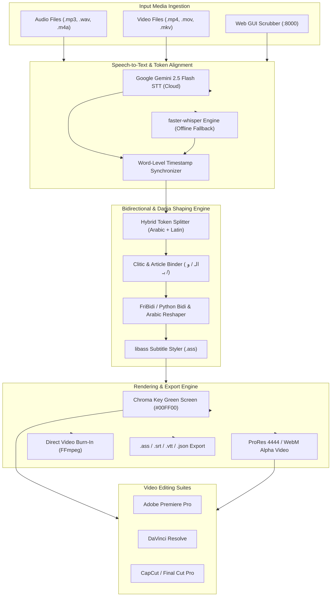

# 🎙️ DZ Subtitles AI — مولّد الترجمة الجزائرية المتحركة

<div align="center">

[-brightgreen?style=for-the-badge)](https://github.com/Maliksouhildev/subtitles-generator-)
[](https://ai.google.dev)
[](https://fastapi.tiangolo.com)
[](https://ffmpeg.org)
[](https://docker.com)
[](LICENSE)

**High-performance automated word-by-word animated subtitle generator purpose-built for Algerian Darija with bidirectional RTL/LTR text shaping, Gemini multimodal speech-to-text, and Chroma Key Green Screen export.**

[Overview](#-overview) • [Architecture](#-system-architecture) • [Features](#-features) • [Quick Start](#-quick-start) • [Video Editors Guide](#-video-editors-guide-chroma-key--alpha) • [CLI & API](#%EF%B8%8F-cli--api-usage)

</div>

---

## 🌟 Overview

Spoken Algerian Arabic (**الدارجة الجزائرية**) is a rich dialect featuring code-switching between Arabic, French, and Amazigh. Standard speech-to-text engines often hallucinate, drop phonetic clitics, or crash when rendering bidirectional text (Arabic RTL mixed with French LTR words).

**DZ Subtitles AI** solves these challenges end-to-end:
- Accurately transcribes spoken Darija slang and loanwords using fine-tuned Gemini prompts with offline `faster-whisper` fallback.
- Resolves complex bidirectional Arabic-Latin token boundaries (`split_fused_script_tokens`) to ensure seamless visual reading flow.
- Generates viral, animated word-by-word subtitles (Karaoke pop, highlight badge, progressive reveal) on transparent, green screen, or direct video burn-in.

---

## 🏛️ System Architecture



---

## ✨ Features

- 🇩🇿 **Tuned for Algerian Darija**: Recognizes slang, regional accents (Algiers, Oran, Constantine, Annaba), and conversational loanwords.
- 🔀 **Advanced BiDi Mixed-Script Shaping**: Corrects the classic bug where French words within an Arabic sentence flip to the wrong position.
- 🎨 **Dynamic Animation Presets**:
  - **Karaoke Pop & Scale**: Active word pops forward with neon glow as spoken.
  - **Color Highlight**: Subtle color transition highlighting rhythm and stress.
  - **Bounding Badge**: Modern social-media style rounded box behind active phrases.
  - **Smooth Fade**: Elegant broadcast title bar.
- 🔤 **Bundled Arabic Typography**: Pre-packaged with open-source fonts: *Cairo*, *Tajawal*, *Almarai*, and *Amiri*.
- 🖥️ **Dark Glassmorphic Web UI**: Full interactive editor allowing manual word correction, timestamp nudging, and live canvas preview.
- 📐 **Multiple Aspect Ratios**: 9:16 (Shorts/TikTok/Reels), 16:9 (YouTube/Landscape), 1:1 (Square).

---

## 🚀 Quick Start

### 1. Prerequisites
- **Python**: 3.10+
- **FFmpeg**: Must be installed with `libass` support (`ffmpeg -version`)

### 2. Standard Installation

```bash
# Clone the repository
git clone https://github.com/Maliksouhildev/subtitles-generator-.git
cd subtitles-generator-

# Install Python requirements
pip install -r requirements.txt
```

### 3. Environment Setup

```bash
cp .env.example .env
```
Add your free Gemini API key:
```ini
GEMINI_API_KEY=your_gemini_api_key_here
```

### 4. Launch the Web Interface

```bash
# On Windows:
.\start.bat

# On Linux / macOS:
chmod +x start.sh
./start.sh
```

Or start the server directly:
```bash
python server.py
```
Open **[http://localhost:8000](http://localhost:8000)** in your browser.

---

## 🎬 Video Editors Guide (Chroma Key & Alpha)

### Adobe Premiere Pro / DaVinci Resolve / CapCut:
1. **Green Screen Export (`#00FF00`)**:
   - Import the rendered subtitle video above your main footage track.
   - Apply the **Ultra Key** effect (Premiere) or **3D Keyer** (DaVinci).
   - Use the color picker on the green background.
2. **Black Screen Export (Blend Mode)**:
   - Place subtitle clip above footage.
   - Change clip blend mode to **Screen** (`Écran`). The black background disappears instantly with zero keying artifacts.
3. **Transparent Alpha Video**:
   - Choose **ProRes 4444** or **WebM** in the web export menu for native transparent overlays with zero keying required.

---

## ⚙️ CLI & API Usage

### Command Line Interface (CLI)
Generate subtitles directly from terminal:

```bash
python cli.py --input speech.mp3 --style karaoke --bg green --output subtitles_green.mp4
```

### REST API Integration
FastAPI exposes endpoints for automated external pipelines (e.g. n8n or serverless workers):
- `POST /api/transcribe`: Ingests audio/video and returns aligned word tokens.
- `POST /api/render`: Builds `.ass` file and renders styled video via FFmpeg.
- `GET /api/health`: Health status and GPU/CPU resource monitor.

---

## 🐳 Docker Deployment

Run the complete pipeline in an isolated container:

```bash
docker-compose up -d --build
```
Access the application at `http://localhost:8000`.

---

## 🤝 Contributing & License

Contributions, bug fixes, and feature requests are welcome.

Distributed under the **MIT License**. Created & maintained by [Maliksouhildev](https://github.com/Maliksouhildev).
